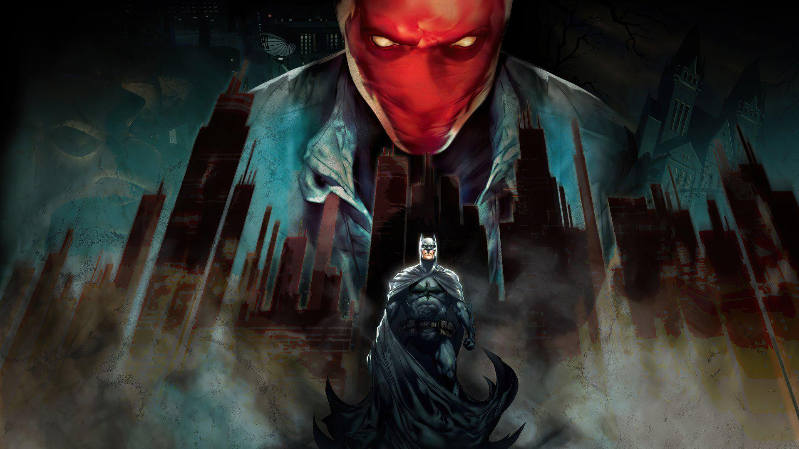
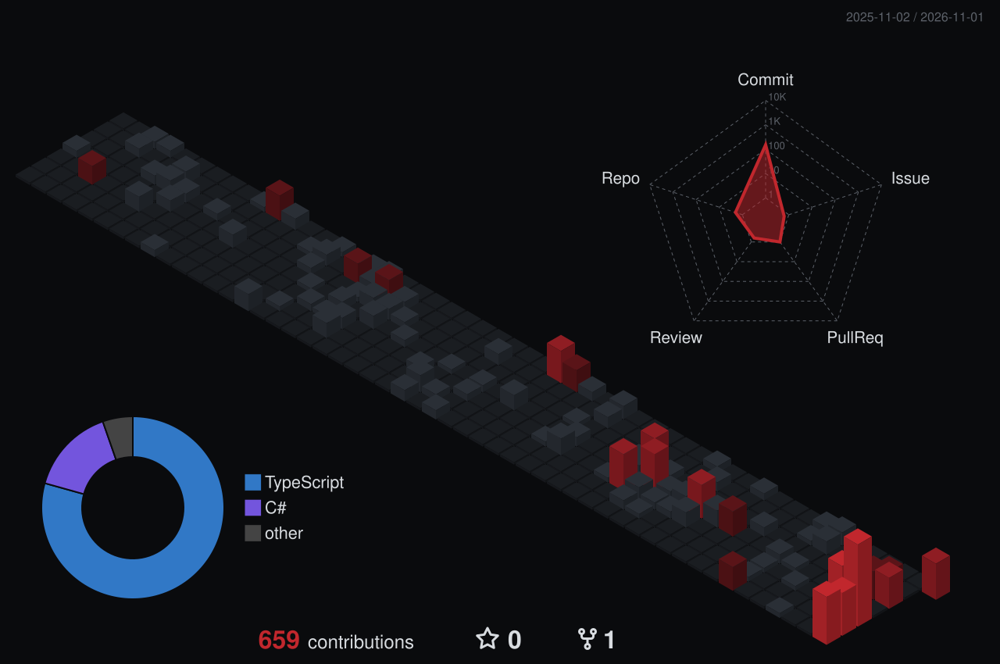

	

<i>Every codebase has a city's worth of ghosts in it. I'm the one who goes in after dark to deal with them.</i>

	
  	

	

&#129703; &nbsp;<b>Gabriel Alves.</b> A software developer who learned the job the hard way, by shipping and fixing real production code.

&#127891; &nbsp;Graduated in Systems Analysis and Development.

&#128295; &nbsp;I mostly work with Java, Spring Boot, ReactJS, C# and React Native, and I like picking whichever tool fits the problem.

&#127970; &nbsp;Right now I'm at FBM Brasil, a multinational company, working daily with .NET, Vue and Spring Boot.

&#128218; &nbsp;Lately I'm digging deeper into web development and Spring Boot 3.

&#128188; &nbsp;Before that I spent time at C6 Bank and PayGo.

&#129309; &nbsp;Always up for a new team or a good project. Send a signal and let's talk.

 

  

  

**Languages**

&nbsp;
&nbsp;
&nbsp;
&nbsp;

**Gadgets & Tools**

&nbsp;
&nbsp;
&nbsp;
&nbsp;
&nbsp;
&nbsp;
&nbsp;
&nbsp;
&nbsp;
&nbsp;

**Full Stack Developer** @ FBM Brasil · *Feb 2023 to Present*
> Building and improving internal tools to configure and analyze live game servers, using Java Spring Boot, Vue.js, React, ASP.NET Core and PostgreSQL. Built a log analysis system on Elasticsearch that made production errors much easier to catch and fix. Also support a C# WebSocket server backed by MySQL, where a new communication layer cut response time by 20%.

**Front End Developer** @ C6 Bank · *Aug 2022 to Feb 2023*
> Web banking front end with React, Atomic Design and Material UI. Wrote a Node.js BFF, covered the code with Jest and Testing Library (15% fewer production errors) and documented components in Storybook.

**Full Stack Developer** @ PayGo Pagamentos · *Jul 2021 to Jul 2022*
> Rebuilt the company's backoffice in React (25% more productivity for internal users) and shipped a REST API in C# and .NET following DDD, which improved performance by 40%.

**Freelance projects**
> **Vigya**, an AI security platform for retail. Java 17, Spring Boot 3 and PostgreSQL API covering e-signed contracts, recurring billing, real-time alerts through SSE and Telegram, and AI worker orchestration. Deployed with Docker on AWS, with JWT auth, ~300 tests and CI/CD.
>
> **Rebox Assistencia**, a 24/7 roadside assistance platform. Rebuilt the site with Next.js, fixed a pagination bug that was crashing the Node API, migrated to AWS Amplify and added a WhatsApp chatbot that cut about 40% of manual calls.
>
> **Web ERP** for small business owners (React, Spring Boot, AWS with NGINX), plus a **hardware monitor** with Slack alerts and an **energy consumption tracker** built on React, Node.js and Azure.

| Project | Description | Stacks |
|---------|-------------|--------|
| [Guildcraft](https://github.com/ogabrielalves/guildcraft) | A pixel-art guild workshop where every adventurer is a live Claude Code agent. Each project folder gets its own character, so you can see who is working, idle or waiting for permission. Work in progress. | `nodejs` `typescript` `websocket` `canvas` |

